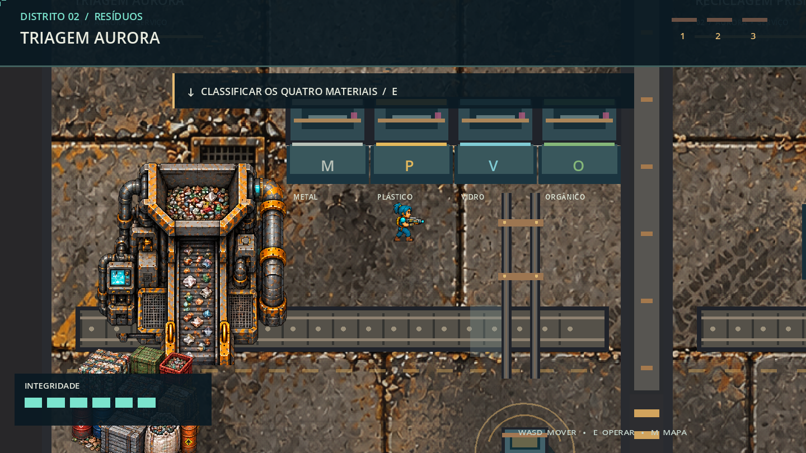
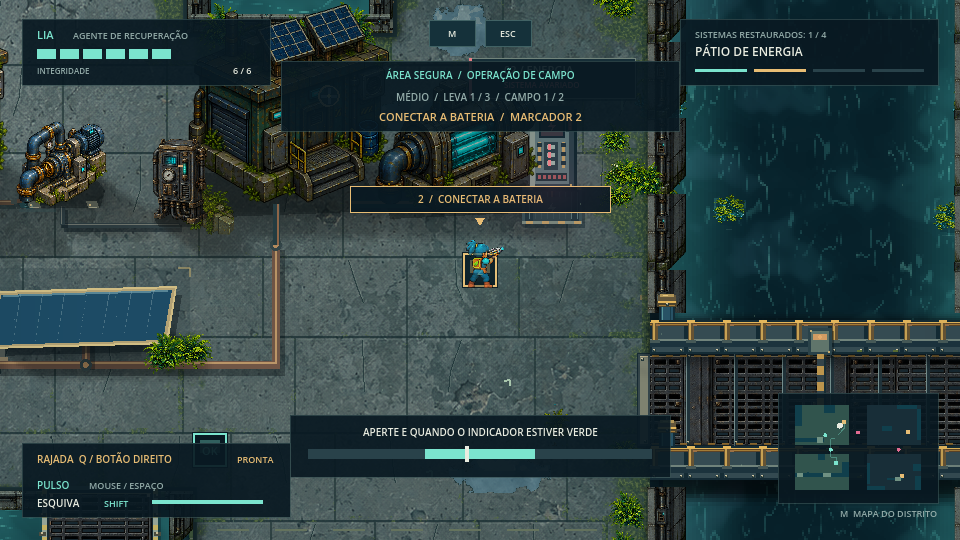

# Protocolo 17 — Aurora

Beta candidata **0.2.1** em Godot 4.7.1. Lia recupera o Distrito das Águas de Aurora: captação, energia, filtragem e distribuição. A operação combina ação em visão superior, tarefas ambientais, melhorias e confronto final, ligada ao ODS 6 — água potável e saneamento. Esta branch também contém a primeira versão jogável do **Distrito de Resíduos**, acessível após concluir Águas.

## Executar

1. Abra o `project.godot` da raiz no Godot 4.7.1.
2. Aguarde a importação dos recursos e pressione F5.
3. Escolha uma nova operação e o nível de dificuldade. O prólogo existente pode ser pulado.

O projeto usa o renderer Compatibility e não exige dependências externas. Saves e configurações da beta ficam na pasta de dados `Protocolo17Beta`, separada da alpha.

## Distrito de Resíduos

Após a vitória em Águas, selecione **Seguir ao Distrito de Resíduos**. Também é possível abrir `scenes/residues.tscn` diretamente no editor para revisar a fase. O pátio seco contém triagem de metal, plástico, vidro e orgânicos, prensagem, compostagem, bloqueios de sucata, drones e uma coletora pesada. Use **E** para recolher e entregar materiais e para manter operações de reparo; **M** mostra o mapa. A dificuldade e as melhorias de Águas são transferidas durante a execução. Salvar o progresso de Resíduos entre sessões e seguir para Energia ainda não estão implementados.



[Mapa, mecânicas e direção visual](docs/direcao-visual/distrito-de-residuos.md) · [Revisão da prensa](captures/residuos/03-prisma.png) · [Revisão da compostagem](captures/residuos/04-iris.png).

## Dificuldades

| Nível | Vida inicial | Inimigos por campanha sem derrotas |
| --- | ---: | ---: |
| Fácil | 9 | 37 |
| Médio | 6 | 57 |
| Difícil | 5 | 77 |

A dificuldade altera quantidade de inimigos, velocidade dos projéteis, pressão e tolerância da sincronização. O checkpoint preserva o nível escolhido.

## Controles

| Ação | Controle |
| --- | --- |
| Movimento | WASD ou setas |
| Mira | Mouse |
| Disparo | Botão esquerdo ou Espaço |
| Rajada de cinco pulsos | Q ou botão direito |
| Esquiva | Shift |
| Operar e reparar | E |
| Escolher tratamento ou melhoria | 1, 2, 3 ou mouse |
| Mapa | M |
| Pausa | Esc |
| Tela cheia | F11 |
| Alternar áudio | F10 |

Na energia, aperte E quando o indicador estiver na faixa verde. Nas outras tarefas, segure E. Complete duas tarefas e três levas por setor, depois repare o terminal. A derrota reinicia o setor atual, preservando setores anteriores e melhorias; cada novo setor começa com vida cheia.

## Novidades da beta

- Quatro setores com oito tarefas: admissão, sincronização elétrica, análise de amostra, filtração e abertura das redes de distribuição.
- Reforços por dificuldade, rajada secundária com recarga e chefe com três fases.
- Tiros no tamanho original e projéteis inimigos mais rápidos; sinais de preparação sem linhas de previsão do ataque.
- Tarefa da bateria visível à frente do gerador, objetivos no mapa e HUD com indicação da leva e tarefa.
- Correções de toque curto em E, ações acumuladas na pausa/diálogo, leitura do HUD e persistência.



## Validação e pendências

Foram realizadas 21 campanhas automatizadas com dano normal, com 18 vitórias, além de testes de regras, interface, saves, colisões e mais de 215 mil quadros em baterias de esforço. O controlador não usa invulnerabilidade ou teleporte nessas campanhas.

A combinação exclusivamente de mobilidade no Difícil não concluiu a última bateria; a suíte de resistência não está integralmente aprovada. Também permanecem teste humano de balanceamento e duração, validação em outro computador e acompanhamento de avisos intermitentes na saída de testes gráficos. A meta provisória de dez minutos humanos ainda não foi comprovada.

[Relatório completo da 0.2.1](docs/BETA_021_DEBUG.md) · [Auditoria da beta](docs/BETA_AUDITORIA.md) · [Roteiro de teste humano](docs/ROTEIRO_PLAYTEST_BETA.md).

## Reproduzir os testes

Substitua `godot` pelo caminho do Godot 4.7.1 instalado:

```sh
godot --headless --path . --editor --import --quit
godot --headless --path . --script tests/test_beta_rules.gd
godot --headless --path . --script tests/test_residues.gd
godot --headless --path . --script tests/test_beta_input.gd
godot --headless --path . --script tests/test_beta_storage.gd
godot --headless --path . --script tests/test_simulation.gd
godot --headless --path . --script tests/test_beta_playthrough.gd
godot --headless --path . --script tests/test_beta_stress.gd
godot --headless --path . --script tests/test_beta_endurance.gd
godot --path . --script tools/review_beta.gd --audio-driver Dummy
godot --path . --script tools/review_residues.gd --audio-driver Dummy
```

O teste de resistência pode retornar falha na combinação de mobilidade no Difícil, conforme o relatório. As verificações visuais e de shaders precisam de renderer gráfico.

## Arte e estrutura

Lia mantém 24 orientações, mira livre e oito quadros de caminhada por direção. Os inimigos usam arte animada e efeitos sonoros próprios. Águas conserva água animada, vegetação, pontes, máquinas e estruturas modulares; Resíduos usa concreto seco, poeira, esteiras, fardos e máquinas de separação.

- `scripts/`, `scenes/`: jogo e apresentação.
- `assets/`: arte, áudio sintetizado em execução, fontes e proveniência.
- `tests/`, `tools/`: validação e capturas.
- `docs/`, `captures/beta_021/`: decisões, evidências e revisão visual.

[Lia](assets/lia_directional/README.md) · [Inimigos](assets/enemies/README.md) · [Estação](assets/station/README.md) · [Prólogo](docs/prologo.md).

Arquivos de importação de trabalho, saves, executáveis e pacotes gerados não precisam ser versionados. A exportação Windows está configurada em `export_presets.cfg` e requer os modelos de exportação correspondentes do Godot.
