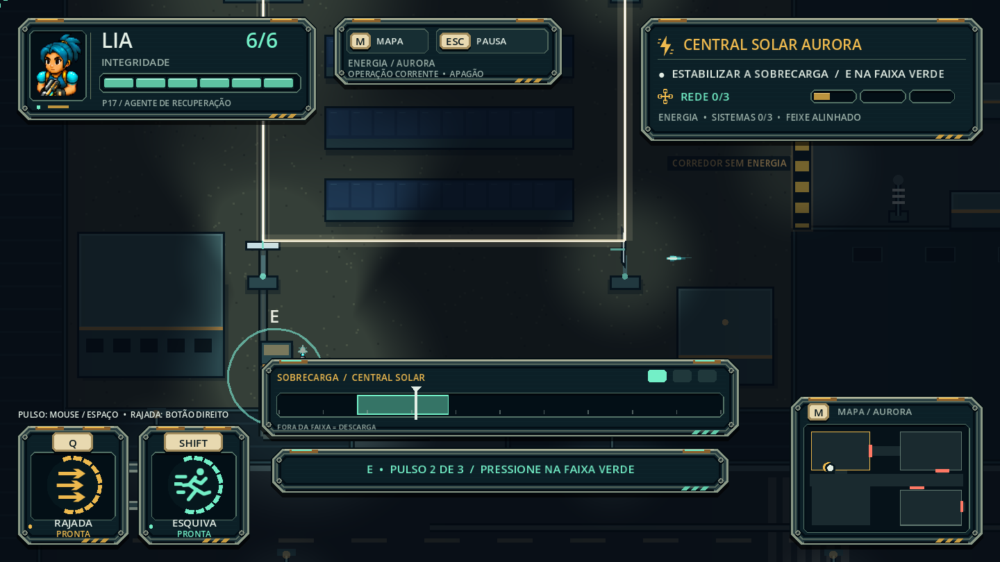
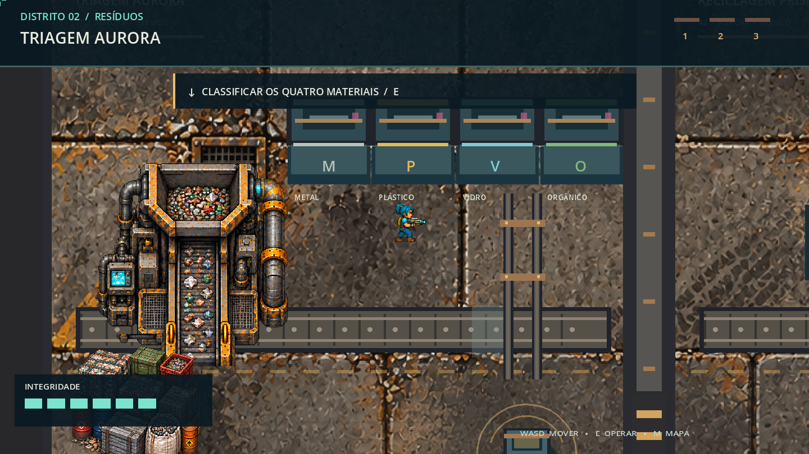
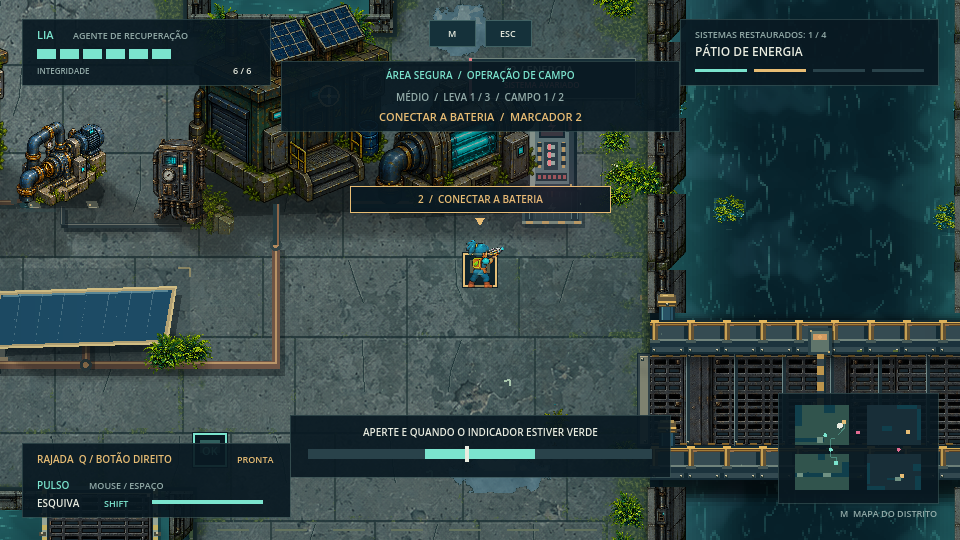

# Protocolo 17 — Aurora

Beta candidata **0.2.2** em Godot 4.7.1. Lia recupera o Distrito das Águas de Aurora: captação, energia, filtragem e distribuição. A operação combina ação em visão superior, tarefas ambientais, melhorias e confronto final, ligada ao ODS 6 — água potável e saneamento. O **Distrito de Resíduos** é desbloqueado permanentemente após concluir Águas.

## Seleção de distritos — 0.2.2

Iniciar operação abre a seleção de Águas, Resíduos e Energia. Águas está sempre disponível; Resíduos fica bloqueado até a primeira vitória em Águas, e Energia até a vitória em Resíduos. O desbloqueio e as três melhorias da última conclusão ficam em `user://aurora_campaign.json`, separados do checkpoint de Águas. Fechar o jogo ou iniciar Águas novamente não apaga o acesso a Resíduos. Ao escolher Resíduos, selecione a dificuldade; as melhorias da última conclusão de Águas serão aplicadas.

Em Resíduos, use a pausa e **Escolher distrito** para voltar à seleção. A derrota e a vitória também oferecem esse retorno. Sair de uma tentativa reinicia as tarefas de Resíduos; o acesso e as melhorias continuam salvos. O progresso dentro de Resíduos ainda não é salvo entre sessões.

Os inimigos de Resíduos usam a mesma regra de resistência do último setor de Águas: explorador com 11 de vida, sentinela com 13 e chefe com 80. Drones de alarme têm 11. Vida atual e máxima ficam registradas por inimigo e as barras usam esses valores; melhorias de dano continuam funcionando. Mapa e pausa do HUD de Resíduos também aceitam clique, e pausar descarta ataques pendentes.

Validação adicional: `tests/test_campaign_selection.gd`, `tests/test_residue_health.gd`, `tests/test_residue_transition.gd` e `tools/review_district_selection.gd`. Execute testes de persistência com uma pasta de dados separada para não alterar seu progresso.

## Executar

1. Abra o `project.godot` da raiz no Godot 4.7.1.
2. Aguarde a importação dos recursos e pressione F5.
3. Escolha uma nova operação, o distrito e o nível de dificuldade. O prólogo de Águas pode ser pulado.

O projeto usa o renderer Compatibility e não exige dependências externas. Saves e configurações da beta ficam na pasta de dados `Protocolo17Beta`, separada da alpha.

## Distrito de Resíduos

Após a vitória em Águas, selecione **Seguir ao Distrito de Resíduos**. Também é possível abrir `scenes/residues.tscn` diretamente no editor para revisar a fase. O bairro industrial possui uma avenida de serviço, ruas de acesso, galpão de triagem com docas abertas, usina de reciclagem e compostagem cercada. Prensas, esteiras, braços, postes, caminhão de coleta e estoques explicam o funcionamento do lugar. Use **E** para recolher e classificar materiais, liberar as esteiras e reabrir a ventilação; **M** mostra o mapa e a rota pelas entradas. Dificuldade e melhorias de Águas são transferidas durante a execução. A vitória em Resíduos abre a **oficina de módulos** (Isolamento, Sobrecarga controlada ou Pulso condutor), salva a conclusão e segue direto para o Distrito de Energia.

## Distrito de Energia — Operação Corrente

Última fase antes do confronto final, desbloqueada após Resíduos (card **03 / ENERGIA**). A IA apagou o distrito: a Lia avança no escuro com uma lanterna, e cada instalação restaurada acende o setor.

- **Central Solar Aurora:** atire nos espelhos para levar o feixe ao coletor. Depois faça a **Sobrecarga**: três toques de E na faixa verde, que se move e encolhe. Errar descarrega e trava o console.
- **Torre de Distribuição Norte:** atravesse os arcos rítmicos do corredor e destrua o transformador que dá escudo aos drones. Energize os três relés com tiros dentro da janela e estabilize a rede oscilante.
- **Banco de Baterias Central:** fique no anel para carregar a reserva enquanto alivia as células críticas nos consoles, sob quatro ondas.
- **Elevador do Núcleo:** encerra a operação.

Os três fragmentos do registro de Beatrix fecham a história do comando redigido. A vitória salva a campanha; o card **04 / NÚCLEO AURORA** aparece como "em produção".

A arte atual é provisória, desenhada em código sobre a geometria final. Os prompts do Codex estão em [assets/power/PROMPTS.md](assets/power/PROMPTS.md); o jogo troca para os setores pintados assim que os arquivos existirem.



[Mapa, mecânicas e inimigos](docs/direcao-visual/distrito-de-energia.md) · [Design do chefe final](docs/direcao-visual/nucleo-aurora.md) · [Distrito apagado](captures/energia/08-distrito-apagado.png) · [Distrito aceso](captures/energia/08-distrito-aceso.png) · [Banco de Baterias](captures/energia/06-baterias.png).

Testes: `test_power_mechanics`, `test_power`, `test_power_collision`, `test_power_smoke` e `test_campaign_flow`. Capturas: `tools/review_power.gd` (precisa de renderização, sem `--headless`).



[Mapa, mecânicas e direção visual](docs/direcao-visual/distrito-de-residuos.md) · [Revisão da prensa](captures/residuos/03-prisma.png) · [Revisão da compostagem](captures/residuos/04-iris.png).

[Visão geral do bairro](captures/residuos/06-bairro-completo.png) · [Vista em 960×540](captures/residuos/08-triagem-960.png) · [Auditoria de colisões](captures/residuos/09-colisoes.png) · [Fontes da arte](assets/residues/README.md).

Resíduos reutiliza as poses, o recuo, o clarão e o pulso de Águas. Os galpões têm pisos de trabalho abertos, a triagem possui uma entrada ampla e os biodigestores deixam uma passagem central. Jogador, robôs e projéteis consultam a mesma geometria; esquivas verificam todo o deslocamento. O fundo usa quatro setores de 1536×1024, cobrindo o bairro em 3072×2048 sem aumentar a escala da personagem.

## Dificuldades

| Nível | Vida inicial | Inimigos por campanha sem derrotas |
| --- | ---: | ---: |
| Fácil | 9 | 37 |
| Médio | 6 | 57 |
| Difícil | 5 | 77 |

A dificuldade altera quantidade de inimigos, velocidade dos projéteis, pressão e tolerância da sincronização. O checkpoint preserva o nível escolhido.

## Controles

| Ação | Controle |
| --- | --- |
| Movimento | WASD ou setas |
| Mira | Mouse |
| Disparo | Botão esquerdo ou Espaço |
| Rajada de cinco pulsos | Q ou botão direito |
| Esquiva | Shift |
| Operar e reparar | E |
| Escolher tratamento ou melhoria | 1, 2, 3 ou mouse |
| Mapa | M |
| Pausa | Esc |
| Tela cheia | F11 |
| Alternar áudio | F10 |

Na energia, aperte E quando o indicador estiver na faixa verde. Nas outras tarefas, segure E. Complete duas tarefas e três levas por setor, depois repare o terminal. A derrota reinicia o setor atual, preservando setores anteriores e melhorias; cada novo setor começa com vida cheia.

## Novidades da beta

- Quatro setores com oito tarefas: admissão, sincronização elétrica, análise de amostra, filtração e abertura das redes de distribuição.
- Reforços por dificuldade, rajada secundária com recarga e chefe com três fases.
- Tiros no tamanho original e projéteis inimigos mais rápidos; sinais de preparação sem linhas de previsão do ataque.
- Tarefa da bateria visível à frente do gerador, objetivos no mapa e HUD com indicação da leva e tarefa.
- Correções de toque curto em E, ações acumuladas na pausa/diálogo, leitura do HUD e persistência.



## Validação e pendências

Foram realizadas 21 campanhas automatizadas com dano normal, com 18 vitórias, além de testes de regras, interface, saves, colisões e mais de 215 mil quadros em baterias de esforço. O controlador não usa invulnerabilidade ou teleporte nessas campanhas.

A combinação exclusivamente de mobilidade no Difícil não concluiu a última bateria; a suíte de resistência não está integralmente aprovada. Também permanecem teste humano de balanceamento e duração, validação em outro computador e acompanhamento de avisos intermitentes na saída de testes gráficos. A meta provisória de dez minutos humanos ainda não foi comprovada.

[Relatório completo da 0.2.1](docs/BETA_021_DEBUG.md) · [Auditoria da beta](docs/BETA_AUDITORIA.md) · [Roteiro de teste humano](docs/ROTEIRO_PLAYTEST_BETA.md).

## Reproduzir os testes

Substitua `godot` pelo caminho do Godot 4.7.1 instalado:

```sh
godot --headless --path . --editor --import --quit
godot --headless --path . --script tests/test_beta_rules.gd
godot --headless --path . --script tests/test_residues.gd
godot --headless --path . --script tests/test_residue_collision.gd
godot --path . --audio-driver Dummy --script tests/test_residue_presentation.gd
bash tests/check_residue_transition.sh
godot --headless --path . --script tests/test_beta_input.gd
godot --headless --path . --script tests/test_beta_storage.gd
godot --headless --path . --script tests/test_simulation.gd
godot --headless --path . --script tests/test_beta_playthrough.gd
godot --headless --path . --script tests/test_beta_stress.gd
godot --headless --path . --script tests/test_beta_endurance.gd
godot --path . --script tools/review_beta.gd --audio-driver Dummy
godot --path . --script tools/review_residues.gd --audio-driver Dummy
```

O teste de resistência pode retornar falha na combinação de mobilidade no Difícil, conforme o relatório. As verificações visuais e de shaders precisam de renderer gráfico.

## Arte e estrutura

Lia mantém 24 orientações, mira livre e oito quadros de caminhada por direção. Os inimigos usam arte animada e efeitos sonoros próprios. Águas conserva água animada, vegetação, pontes, máquinas e estruturas modulares; Resíduos usa concreto seco, poeira, esteiras, fardos e máquinas de separação.

- `scripts/`, `scenes/`: jogo e apresentação.
- `assets/`: arte, áudio sintetizado em execução, fontes e proveniência.
- `tests/`, `tools/`: validação e capturas.
- `docs/`, `captures/beta_021/`: decisões, evidências e revisão visual.

[Lia](assets/lia_directional/README.md) · [Inimigos](assets/enemies/README.md) · [Estação](assets/station/README.md) · [Prólogo](docs/prologo.md).

Arquivos de importação de trabalho, saves, executáveis e pacotes gerados não precisam ser versionados. A exportação Windows está configurada em `export_presets.cfg` e requer os modelos de exportação correspondentes do Godot.
